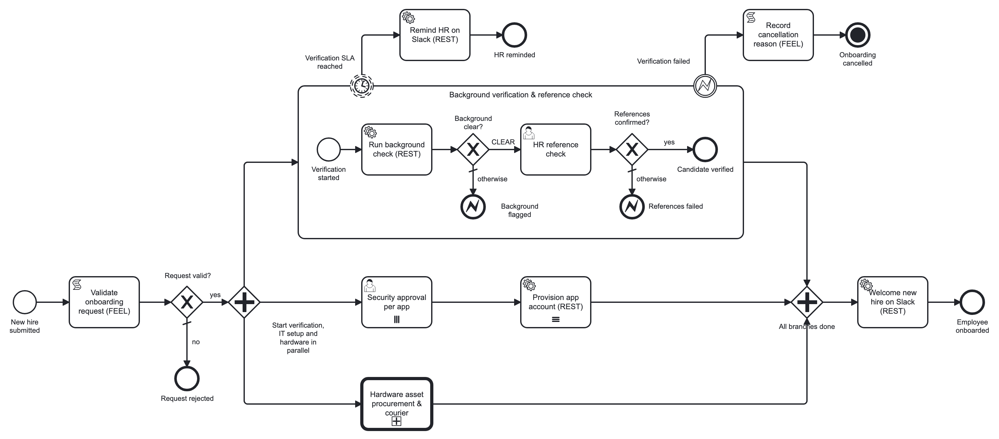
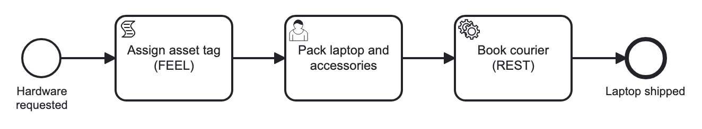

# bpmn-models

BPMN models, Camunda forms, diagrams and deployment instructions for **Zero-Trust Employee Onboarding & Multi-App Provisioning** (Camunda 8.8).

## Contents

| Path | What it is |
|---|---|
| `main/employee-onboarding.bpmn` | Main process, id `employee-onboarding` |
| `child/hardware-procurement.bpmn` | Child process, id `hardware-procurement` (reusable, started by a call activity) |
| `forms/app-access-approval.form` | Form for *Security approval per app* |
| `forms/reference-check.form` | Form for *HR reference check* |
| `forms/hardware-packing.form` | Form for *Pack laptop and accessories* (child process) |
| `test-payloads/*.json` | Start payloads for the test scenarios (synthetic data) |
| `diagrams/*.png` | Rendered diagrams |

## Main process



1. **Validate onboarding request (FEEL script task)** checks the request and derives the username. An invalid request ends at *Request rejected* (default flow).
2. A **parallel gateway** starts three branches:
   - **Background verification & reference check**: an embedded sub-process with a REST background check, an HR reference check and two error end events (`VERIFICATION_FAILED`).
     - **Error boundary:** record the cancellation reason → **terminate end event**. This cancels every other branch, including the hardware child process, so the laptop is never shipped.
     - **Non-interrupting timer boundary:** `=if verificationSla != null then verificationSla else "P3D"` → remind HR on Slack.
   - **Security approval per app**: user task, **parallel multi-instance** over `requestedApps`. Output `appApprovals`.
     Then **Provision app account (REST)**: **sequential multi-instance** over `=appApprovals[approved = true].app`. Output `provisionedAccounts`.
   - **Hardware asset procurement & courier**: **call activity** → `hardware-procurement`, with no variable propagation and explicit input/output mappings.
3. A **parallel join**, then **Welcome new hire on Slack (REST)** → *Employee onboarded*.

## Child process



Assign asset tag (FEEL) → Pack laptop and accessories (user task) → Book courier (REST) → Laptop shipped.

## Connectors and secrets

All HTTP calls use the **REST Outbound Connector** template (`io.camunda.connectors.HttpJson.v2`, version 12), with retries 3 and backoff PT5S.

| Task | Auth | Secret |
|---|---|---|
| Run background check | API key header `X-API-Key` | `{{secrets.BGV_API_KEY}}` |
| Provision app account | Bearer | `{{secrets.IAM_API_TOKEN}}` |
| Remind HR on Slack / Welcome new hire | Bearer | `{{secrets.SLACK_BOT_TOKEN}}` |
| Book courier | none | – |

No secret values are stored in the models. They are supplied to the Connectors runtime as environment variables (see `../.env.example`).

## Data contracts

| Element | Input | Output |
|---|---|---|
| Security approval per app (parallel MI) | `requestedApps` → `app`; `approvalDecision`, `approvalComment` made local (`=null`) | `appApprovals` = list of `{app, approved, comment}` |
| Provision app account (sequential MI) | approved apps → `app`; `provisionedAccount` made local | `provisionedAccounts` = list of `{app, accountId, status}` |
| Hardware call activity | `employeeId`, `fullName`, `laptopModel`, `accessories`, `shippingAddress`, `startDate` | `hardwareShipment` = `{assetTag, serialNumber, trackingId, courier, status}` |

## Deployment

1. Start Camunda 8 Run with the secrets loaded:
   ```bash
   set -a && source ../.env && set +a
   ./start.sh
   ```
   Run this in the c8run folder.
2. Start the mock APIs in `../backend-springboot` (port 8095).
3. In Camunda Desktop Modeler (target Camunda 8.8, c8run local), deploy in this order:
   - the 3 forms
   - `child/hardware-procurement.bpmn`
   - `main/employee-onboarding.bpmn`
4. Start an instance:
   ```bash
   curl -u demo:demo -H "Content-Type: application/json" \
     -X POST http://localhost:8080/v2/process-instances \
     -d @test-payloads/1-happy-path.json
   ```

| Payload | Expected result |
|---|---|
| `1-happy-path.json` | Approve GITHUB, JIRA and SLACK; reject AWS → 3 accounts, laptop shipped, SLA reminder after 45 s → Employee onboarded |
| `2-background-check-failed.json` | EMP-9xxx flagged → error boundary → Onboarding cancelled; hardware child process terminated |
| `3-invalid-request.json` | FEEL validation fails → Request rejected |
